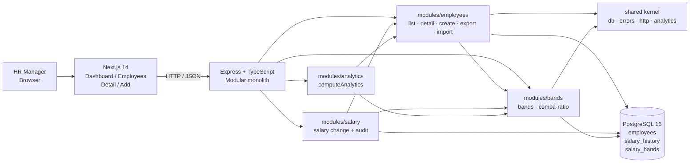

# Architecture — Modular Monolith

## Overview

```
┌──────────────────┐   HTTP/JSON    ┌──────────────────────────────┐   pg Pool   ┌──────────────┐
│ Next.js 14       │ ─────────────► │ Express + TypeScript         │ ──────────► │ PostgreSQL 16│
│ (App Router)     │                │ Modular monolith             │             │ Employee +   │
│ Dashboard /      │                │ modules/employees · salary · │             │ SalaryHistory│
│ Employees /      │                │ analytics · bands + shared   │             │ + SalaryBand │
│ Detail / Add     │                │ kernel                       │             └──────────────┘
└──────────────────┘                └──────────────────────────────┘
```

The same diagram as Mermaid (renderable in GitHub):



One repo, two packages, one Postgres, one deployable backend. No auth
(out of scope, see `REQUIREMENTS.md`). The backend is a **modular
monolith**: a single process/deployable made of loosely-coupled modules
with explicit boundaries, so any module can later be extracted into a
microservice without a rewrite (see "Extracting a microservice" below).

## Backend modules (`backend/src`)

| Area | Contents | Owns |
|---|---|---|
| `modules/employees/` | `employee.types`, `employee.repository` (interface + Pg + InMemory, incl. `existingEmails` + `createMany`), `employee.validation` (Zod), `employee.csv` (shared column list + CSV parser), `employee.service`, `employee.controller` (incl. multer upload), `employee.routes`, `employee.factory`, `index` (public API) | Employee list/search/filter/sort/pagination, detail, create, CSV export + CSV import — every employee returned carries band info (band, compa-ratio, position) via the bands service |
| `modules/salary/` | `salary.service`, `salary.controller`, `salary.routes`, `salary.factory`, `index` | Salary change rule + audit (via the employees repository interface); the updated employee carries band info |
| `modules/analytics/` | `analytics.types`, `analytics.service` (pure `computeAnalytics`), `analytics.controller`, `analytics.routes`, `analytics.factory`, `index` | Dashboard numbers: averages, medians, breakdowns, outliers, band summary |
| `modules/bands/` | `bands.types`, `bands.repository` (interface + Pg + InMemory), `bands.service` (pure `classifySalary`), `bands.controller`, `bands.routes`, `bands.factory`, `index` (public API) | Salary bands (one row per level, monthly USD min–mid–max), compa-ratio maths, band position; the one service every other module consumes for band data |
| `shared/` | `db` (pool factory), `errors` (ApiError), `http` (asyncHandler, error/not-found handlers), `analytics` (median, average, FX, pagination meta) | Only truly cross-cutting code — nothing module-specific |
| `seed/` | `seedData` (deterministic generator), `employeeFactory` (Factory) | The 10,000-employee seed |
| `app.ts` | Composition root only | Wiring: pool → module factories → routers; no business logic, no SQL |
| `index.ts` | Bootstrap only | `listen()` — no logic, excluded from coverage |

### Module boundaries (the rules)

1. **Each module owns its routes, controller, service and repository.**
   Nothing outside a module imports its internals — only its `index.ts`
   public API (types + repository interface + factory).
2. **Modules talk only through another module's public service/repository
   interface, never its tables.** Example: `SalaryService` imports only
   the `EmployeeRepository` interface from `modules/employees/index.ts`
   and never writes SQL against `employees` itself — the atomic
   update-plus-history write lives in the employees repository. (The
   salary module's *factory* reuses the same pool-to-repository wiring
   helper as the employees factory; that is composition, not data access.)
3. **No business logic in controllers, no SQL in services, no DB access
   from routes.** Controllers validate (Zod) → call a service → shape the
   response. Services hold rules. Repositories are the only place that
   knows SQL.
4. **Dependencies flow one way:** routes → controller → service →
   repository → `pg` pool. The shared kernel is imported by modules, never
   the reverse. One exception, by design: the employees, salary and
   analytics services all consume the bands module's `BandService`
   (injected by `app.ts`, which builds one bands module and shares it),
   so every response agrees on the same band numbers. Bands never
   imports the other modules — the dependency is one-way.

## Frontend (`frontend/src`, Next.js 14 App Router)

- `app/` — file routes: `/` (Dashboard), `/employees`, `/employees/new`,
  `/employees/[id]`; `layout.tsx` (nav + metadata). All pages are
  `'use client'` components that fetch from the backend at runtime — the
  data is dynamic HR data, so there is no SSR data fetching; Next.js is
  used for file routing, layouts, metadata and production conventions.
  The dashboard shows the salary-band position counts (below / within /
  above); the detail page shows the employee's band (min–mid–max),
  compa-ratio and a position badge.
- `features/employees/` — the typed API client (`api.ts`) + types
  (single source of truth for `Employee`, `Analytics`, …) +
  `ImportEmployees.tsx` (CSV import button, file picker, per-row report).
  The sample CSV lives at `frontend/public/sample-employees.csv` (the
  exact export columns, 3 example rows) and is linked from the import UI.
- `shared/components/` — `StatCard`, `BarList`.
- `shared/lib/constants.ts` — departments, countries + currencies, levels
  (single source; pages import it instead of re-listing — DRY).
- `shared/utils/format.ts` — money/date formatting.

## API endpoints

| Method + path | Module | Returns |
|---|---|---|
| `GET /api/health` | — | `{ data: { status: "ok" } }` |
| `GET /api/employees?...` | employees | Paged employees (`{ data, meta }`); each row carries `band` (min/mid/max USD), `compaRatio` and `bandPosition` |
| `GET /api/employees/:id` | employees | Employee + `salaryHistory` + band info |
| `POST /api/employees` | employees | Created employee + band info (201) |
| `PATCH /api/employees/:id/salary` | salary | `{ employee, history }`; employee carries band info |
| `GET /api/employees/export?format=csv` | employees | Streamed CSV of the filtered list |
| `POST /api/employees/import` | employees | `{ data: { totalRows, imported, failed: [{ row, reason }] } }` (200); 400 for a missing/non-CSV/over-5 MB file, an empty file, or a wrong header |
| `GET /api/bands` | bands | All six level bands, Junior first |
| `GET /api/bands/:level` | bands | One band, or 404 for an unknown level |
| `GET /api/analytics/summary` | analytics | Headcount, payroll, averages/medians, breakdowns, distribution, top earners, outliers, `bandSummary` |

Every response uses one envelope: success `{ data, meta? }`, error
`{ error: { code, message, details? } }`.

## Request flow (example)

HR searches "Priya" → Next.js page waits 250 ms (debounce), calls
`GET /api/employees?search=Priya&page=1&pageSize=20` → employees router →
controller validates the query with Zod → `EmployeeService` → repository
runs one indexed `WHERE first_name ILIKE …` query with `LIMIT/OFFSET` +
a `COUNT` → controller returns
`{ data: [20 employees], meta: { total, page, totalPages } }` → the table
renders 20 rows, not 10,000.

## Salary-change flow (example)

`PATCH /api/employees/:id/salary` → salary controller validates
(`newSalary > 0`, `reason` required) → `SalaryService` loads the employee
through the repository interface, rejects a salary equal to the current
one → repository opens a transaction: update `employees.base_salary` AND
insert a `SalaryHistory` row (old, new, reason, changedBy, time) → commit.
If either write fails, both roll back.

## CSV-import flow (example)

HR picks a `.csv` file on the Employees page → `POST
/api/employees/import` (multipart, field `file`, max 5 MB) → multer
holds the file in memory and rejects non-CSV names before the handler
runs → `EmployeeService.importEmployees` parses the text with the
module's CSV parser, rejects an empty file or a header that is not
exactly the export columns → every data row is validated with the same
`createEmployeeSchema` the single-create endpoint uses (baseSalary
converted from text first) → rows with a duplicate email (inside the
file, or already stored — one `existingEmails` lookup) are reported as
failed → all remaining valid rows are inserted by one multi-row INSERT
(a single statement, so one implicit transaction: all commit together
or none do) → the handler returns `{ data: { totalRows, imported,
failed: [{ row, reason }] } }` and the UI shows the imported count plus
every failed row with its file row number and reason. The `id` column
is accepted (so an exported file round-trips) but ignored — the
repository assigns fresh ids.

## Error envelope

Every API response: success `{ data, meta? }`, error
`{ error: { code, message, details? } }` with proper HTTP status (400
validation, 404 not found, 500 server). The frontend shows the message,
never a stack trace.

## Extracting a microservice (the path, if it is ever needed)

Because modules already own their data access and talk through interfaces,
extraction is mechanical, not a rewrite:

1. **Pick a module, e.g. `salary`.** Move `modules/salary/` + the
   `SalaryHistory` table + its repository methods into a new service.
   The employees module keeps the `employees` table; salary keeps
   `salary_history`.
2. **Replace the in-process call with an HTTP call.** `SalaryService`
   currently takes an `EmployeeRepository`; give it an
   `EmployeeClient` implementing the same interface over HTTP
   (`GET /employees/:id`, `POST /employees/:id/salary-applied`).
   Callers do not change — they still call `SalaryService`.
3. **Keep the contract.** The salary module's routes and response shapes
   stay identical, so the Next.js frontend does not change.
4. **What stays in the monolith:** the shared kernel's error envelope and
   pagination helpers (copied, not shared as a library, to avoid coupling),
   and the other modules until they are extracted the same way.
5. **What changes:** the salary transaction can no longer span both
   tables in one Postgres transaction — it becomes a saga/outbox pattern
   (write the salary change + an outbox event, then apply the history).
   That is a real cost, which is why extraction is deferred until a
   module genuinely needs independent scaling or ownership.

## Deployment (phase 2)

Backend + Postgres on Render, frontend on Vercel — see the runbook
`docs/DEPLOYMENT.md` and the Render Blueprint `render.yaml` at the
repo root. Deployment + video demo are phase 2 — configs are ready,
the live URLs are not created yet (see `docs/VERIFICATION.md`).

## Performance notes

See `docs/PERFORMANCE.md`. Headlines: server pagination, indexes on
department/country/level/baseSalary/email/name, analytics computed with
grouped SQL + in-memory median on small aggregates, CSV streamed, import
as one multi-row INSERT (max 5 MB upload), seed batched (1,000 rows per insert).
